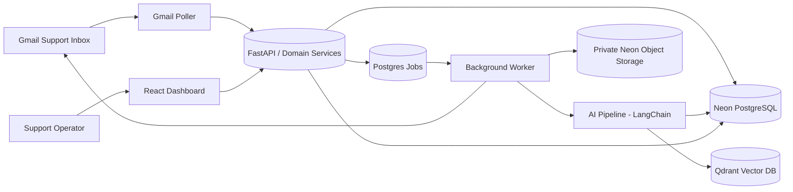
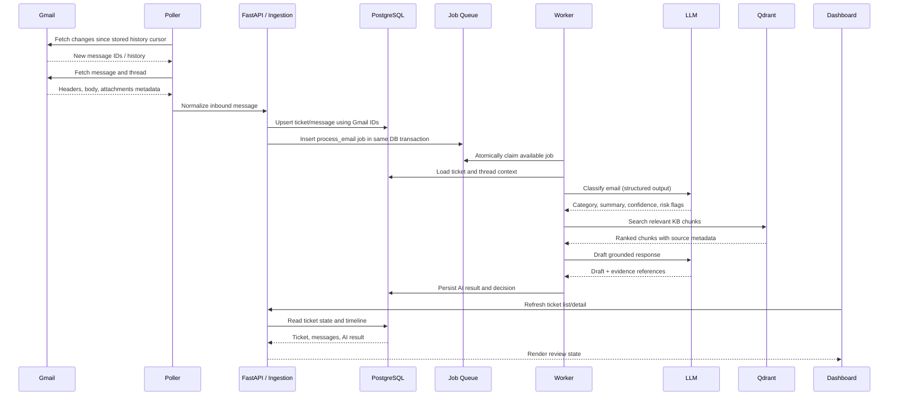
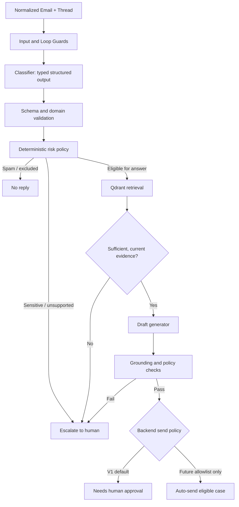
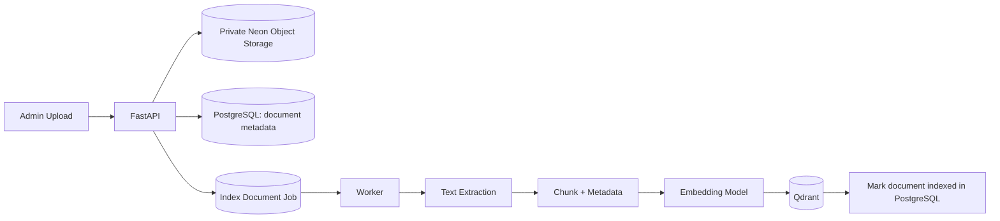
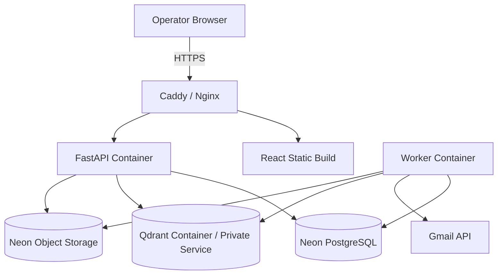

# System Architecture
## AI E-commerce Customer Support Automation

**Architecture style:** modular monolith, separate API and worker processes  
**Scope:** one e-commerce company and one Gmail support inbox

---

## 1. Architecture principles

1. **Persist before processing:** never rely on in-memory state for inbound mail or jobs.
2. **At-least-once execution, idempotent effects:** polling and workers may retry; duplicate records and duplicate sends must be prevented.
3. **Model proposes, backend decides:** LLM output is untrusted input, not business authority.
4. **Human approval by default:** auto-send is a later, narrow capability behind explicit policy and evaluation gates.
5. **PostgreSQL is the operational source of truth:** Qdrant is a retrieval index, not the owner of business state.
6. **Explicit failure states:** every external integration and long-running job can fail visibly and recover safely.

## 2. High-level system



The API and worker are separate processes built from the same backend codebase. The poller can run as a scheduled worker task or a dedicated process. For V1, keep the deployment topology small but isolate each loop so it can be restarted independently.

## 3. End-to-end inbound email flow



## 4. Human approval and Gmail reply flow

```mermaid
sequenceDiagram
    participant O as Operator
    participant UI as React Dashboard
    participant API as FastAPI
    participant DB as PostgreSQL
    participant G as Gmail

    O->>UI: Edit draft and click Approve & Send
    UI->>API: POST /tickets/{id}/send
    API->>DB: Begin transaction; lock ticket/send record
    API->>DB: Re-check status, risk policy, approval, idempotency
    API->>DB: Create send_attempt = pending
    API->>DB: Commit
    API->>G: Send reply in original Gmail thread
    G-->>API: Gmail message ID / result
    API->>DB: Mark send_attempt sent; persist outbound message
    API->>DB: Update ticket status and append audit event
    API-->>UI: Send result
```

Important: do not hold a database transaction open during the Gmail network request. Create a durable send-attempt record first, call Gmail, then persist the result. If the process crashes after Gmail accepts the message but before the DB update, reconcile using Gmail thread/message metadata and the send-attempt correlation marker before retrying. Never blindly resend an uncertain attempt.

## 5. AI pipeline boundaries



### AI stages

1. **Guard:** reject self-sent mail, duplicate IDs, automated notifications, excluded senders, and unsupported content types.
2. **Classify:** LangChain structured output validated against a Pydantic schema with category, priority, summary, entities, risk flags, and confidence.
3. **Policy gate:** deterministic Python rules route sensitive categories directly to escalation.
4. **Retrieve:** embed the query and search active Qdrant chunks; filter by document status/version.
5. **Draft:** provide only the customer message, relevant thread context, and retrieved evidence to the model.
6. **Validate:** validate schema, citations/source IDs, prohibited promises, and evidence sufficiency.
7. **Decide:** backend policy returns `needs_review`, `escalate`, `auto_send`, or `no_reply`.

Stages 2 through 6 are composed with LangChain chains and structured-output calls; retrieval goes through a LangChain Qdrant retriever with metadata filters. Deterministic policy code (stage 7) stays in plain Python.

The model must not have unrestricted access to Gmail send, refunds, order updates, or arbitrary network tools. Sending is a separately authorized backend operation.

## 6. Knowledge-base ingestion flow



### Document lifecycle
`uploaded -> queued -> processing -> indexed` or `failed`; deletion uses `deleting -> deleted`.

- Store original files in a private bucket on Neon Object Storage. Use generated object keys and short-lived presigned URLs for direct browser upload/download.
- Store document version, checksum, owner, MIME type, size, and indexing status in PostgreSQL.
- Chunk with stable chunk IDs and source metadata.
- Upsert Qdrant points with `document_id`, `document_version`, `chunk_id`, source/page/section, and active status.
- On replacement, index the new version and switch the active version only after successful indexing; then remove old vectors.
- On deletion, remove vectors and object data according to retention policy.
- Retrieval must ignore inactive/deleted document versions.

## 7. Backend module boundaries

Suggested structure:

```text
backend/
  pyproject.toml
  uv.lock
  alembic.ini
  app/
    main.py
    core/
      config.py
      security.py
      logging.py
      errors.py
    db/
      session.py
      models/
      migrations/
    modules/
      auth/
      gmail/
        oauth.py
        client.py
        poller.py
        sync.py
      tickets/
        service.py
        repository.py
        schemas.py
      messages/
      ai/
        chains.py
        classifier.py
        drafter.py
        prompts/
        schemas.py
        policy.py
        evaluation/
      knowledge_base/
        service.py
        extraction.py
        chunking.py
        embeddings.py
        qdrant.py
        storage.py
      jobs/
        queue.py
        worker.py
        handlers.py
      audit/
      dashboard/
    api/
      dependencies.py
      routes/
    tests/
  Dockerfile
```

Keep business logic in services, not route handlers. Repositories handle persistence. External clients (Gmail, Neon Object Storage, Qdrant, model provider) are wrapped behind small interfaces so they can be mocked in tests.

## 8. Data model (logical)

### `tickets`
- `id` UUID primary key
- `gmail_thread_id` unique
- `customer_email`, `subject`
- `status`, `category`, `priority`
- `assigned_to` nullable
- `created_at`, `updated_at`, `last_message_at`, `resolved_at`

### `messages`
- `id` UUID primary key
- `ticket_id` foreign key
- `gmail_message_id` unique
- `direction` (`inbound` / `outbound`)
- `from_email`, `to_emails`, `subject`, `body_text`
- `received_at`, `sent_at`
- `headers_json`, `attachments_metadata_json`

### `ai_runs`
- `id`, `ticket_id`, `message_id`
- `model`, `prompt_version`, `pipeline_version`
- `classification_json`, `risk_flags_json`
- `retrieved_chunk_ids`, `draft_text`
- `decision`, `decision_reason`
- `latency_ms`, `token_usage_json`, `created_at`

### `documents`
- `id`, `title`, `object_key`, `mime_type`, `size_bytes`, `checksum`
- `version`, `status`, `uploaded_by`, `created_at`, `indexed_at`

### `document_chunks`
- `id`, `document_id`, `document_version`
- `chunk_index`, `content_hash`, `source_locator`
- `qdrant_point_id`

### `jobs`
- `id`, `job_type`, `payload_json`, `status`
- `attempts`, `max_attempts`, `available_at`
- `locked_by`, `locked_until`, `last_error`
- `created_at`, `updated_at`

### `send_attempts`
- `id`, `ticket_id`, `draft_id` / `ai_run_id`
- `idempotency_key` unique
- `status` (`pending`, `sent`, `failed`, `unknown`)
- `gmail_message_id`, `attempted_at`, `completed_at`, `error`

### `audit_events`
- `id`, `actor_type`, `actor_id`, `ticket_id`
- `event_type`, `event_data_json`, `created_at`

Use JSONB only for genuinely variable provider/model payloads. Keep frequently queried/filterable fields as typed columns. Add indexes for Gmail IDs, ticket status/category, job availability, and audit timelines.

## 9. Durable job lifecycle

Job states: `queued`, `running`, `succeeded`, `retry_wait`, `dead`.

1. API inserts a job in the same transaction as the business record that requires processing.
2. Worker claims one job transactionally using `FOR UPDATE SKIP LOCKED`.
3. Claim sets `locked_by`, `locked_until`, and increments attempts.
4. Worker executes the handler outside the claim transaction.
5. Success marks `succeeded`.
6. Transient failure sets `retry_wait` and exponential backoff with jitter.
7. Permanent failure or max attempts marks `dead`.
8. A reaper recovers jobs whose lease expired.
9. Dashboard exposes dead jobs and safe retry controls.

Handlers must be idempotent. Job payloads should contain stable record IDs, not entire email bodies or secrets.

## 10. API surface (suggested)

| Method | Route | Purpose |
|---|---|---|
| GET | `/api/v1/health` | Liveness |
| GET | `/api/v1/health/ready` | DB/Qdrant/provider readiness |
| GET | `/api/v1/auth/me` | Current dashboard user |
| GET | `/api/v1/gmail/connect` | Start OAuth |
| GET | `/api/v1/gmail/callback` | OAuth callback |
| GET | `/api/v1/tickets` | Filter/paginate tickets |
| GET | `/api/v1/tickets/{id}` | Ticket, messages, AI results |
| POST | `/api/v1/tickets/{id}/draft` | Request a new draft |
| PATCH | `/api/v1/tickets/{id}/draft` | Save operator edits |
| POST | `/api/v1/tickets/{id}/send` | Approve and send |
| POST | `/api/v1/tickets/{id}/escalate` | Escalate ticket |
| POST | `/api/v1/tickets/{id}/resolve` | Resolve ticket |
| GET | `/api/v1/documents` | List KB documents |
| POST | `/api/v1/documents` | Upload document |
| DELETE | `/api/v1/documents/{id}` | Delete document and vectors |
| GET | `/api/v1/jobs` | List failed/recent jobs |
| POST | `/api/v1/jobs/{id}/retry` | Retry eligible dead job |
| GET | `/api/v1/audit-events` | Filter audit history |

Every mutating endpoint requires authentication, authorization, validation, and audit logging. The send endpoint must enforce a server-side state machine and idempotency.

## 11. Security and threat model

| Threat | Control |
|---|---|
| Email prompt injection | Treat email/KB as untrusted data; no prompt text can change code policy or grant tools |
| Model hallucination | Evidence-required drafting; source references; deterministic checks; human approval |
| Duplicate poll/worker execution | Unique Gmail IDs, transactional job claim, idempotent handlers |
| Duplicate outbound reply | Durable send attempt, idempotency key, reconciliation for unknown outcomes |
| OAuth token theft | Server-side encrypted token storage, least privilege, no browser exposure |
| Dashboard compromise | Authentication, secure cookies, CSRF protection, role checks |
| Malicious uploads | Size/type validation, private Neon Object Storage bucket, safe parsers, no execution |
| Data leakage in logs | Redaction, structured logs, restricted log access |
| Database/vector exposure | Private networking/firewall, credentials, TLS where supported |
| Unsafe auto-send | Human approval default; explicit allowlist and evaluation gate |

## 12. Deployment topology



For a single VPS:
- Run frontend, API, worker, and Qdrant using Docker Compose.
- Use Neon as managed PostgreSQL.
- Use private Docker networks; expose only HTTPS (and SSH restricted by firewall).
- Do not expose Qdrant or database ports publicly.
- Persist Qdrant storage on a volume and back it up, or use managed Qdrant if operational simplicity is worth the cost.
- Store secrets outside the image and restrict file permissions.
- Configure health checks, restart policies, log rotation, and backups.
- Use a domain and HTTPS for the dashboard. Gmail OAuth redirect URIs require a stable HTTPS callback in production.

## 13. Testing strategy

### Unit tests
- Classification schema validation.
- Risk policy matrix.
- Prompt-injection and unsupported-evidence handling.
- Chunking and metadata.
- Job retry/backoff and state transitions.
- Gmail message normalization and reply headers.

### Integration tests
- PostgreSQL migrations and job claiming with concurrent workers.
- Qdrant upsert/search/delete.
- Neon Object Storage upload/download against the dev-branch bucket, or a mocked client (path-style S3 adapter behind an interface).
- Gmail API behind a mocked adapter; separate manual sandbox test with a dedicated mailbox.
- API auth and send authorization.

### End-to-end tests
1. Inbound Gmail message is ingested once.
2. Worker creates classification and draft.
3. Unsupported/refund email becomes escalated.
4. Safe policy question becomes `needs_review`.
5. Operator edits and approves; one reply is sent in the original thread.
6. Simulated Gmail timeout creates an `unknown` send attempt and does not blindly resend.
7. KB document upload becomes searchable; deletion removes it from retrieval.
8. Worker crash and lease expiry allow safe recovery.

### Evaluation set
Maintain versioned fixtures with:
- Common shipping/return/product questions.
- Missing or contradictory policy evidence.
- Refund/payment/chargeback requests.
- Angry or threatening customers.
- Prompt injection in email body and quoted thread.
- Spam, auto-replies, and bot loops.
- Duplicate Gmail events.
- Non-English and malformed messages if supported.

Measure risk-case recall and unsupported-answer rate, not just overall classification accuracy.

## 14. Implementation order

Build vertical slices and verify each before adding the next:

1. Project skeleton, settings, DB connection, migrations, health checks.
2. Ticket/message schema and repository tests.
3. PostgreSQL job queue and worker lifecycle.
4. Gmail OAuth and manual mailbox sync.
5. Polling + idempotent ingestion.
6. Neon Object Storage-backed document upload and metadata.
7. Extraction, chunking, embeddings, Qdrant indexing/search.
8. Typed classification and risk policy.
9. Grounded draft generation and evaluation.
10. Human approval and Gmail thread reply.
11. React dashboard connected to real endpoints.
12. Docker deployment, monitoring, backups, and runbook.

## 15. Decisions to revisit only with evidence

- Gmail push notifications instead of polling.
- Dedicated broker (Redis/Celery, RabbitMQ, etc.) instead of PostgreSQL jobs.
- Managed Qdrant instead of self-hosting.
- Multi-inbox or multi-tenant support.
- Live order/shipping integration.
- Narrow auto-send allowlist after robust evaluation.

Do not add these to V1 simply to make the architecture look more complex.
